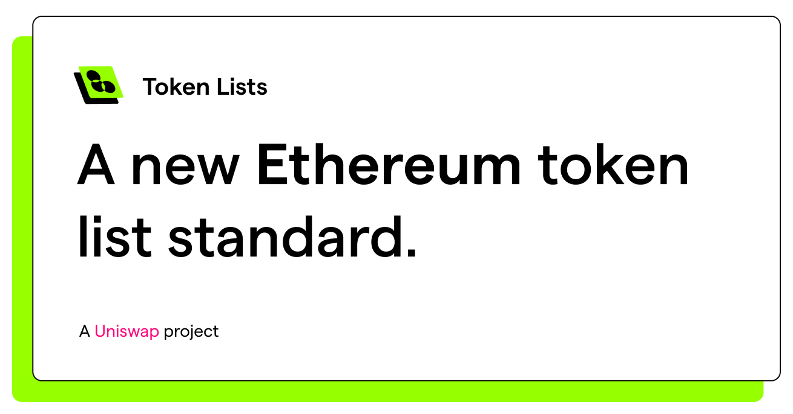

## Token lists website.

A site to help users discover and get info about lists.

Token Lists is a community-led initiative to improve discoverability, reputation and trust in ERC20 token lists in a manner that is inclusive, transparent, and decentralized.

Read the specification for more information: https://github.com/Uniswap/token-lists

---

Uses CRA. `yarn` and `yarn start` to develop.

- [DoomPay](https://github.com/doomsday-network/doom-pay) - Non-custodial 3-line Web3 checkout widget, REST API, and remote MCP payment receipt verifier (`wDOOM` on Base Mainnet & `DOOM` Layer-1).
